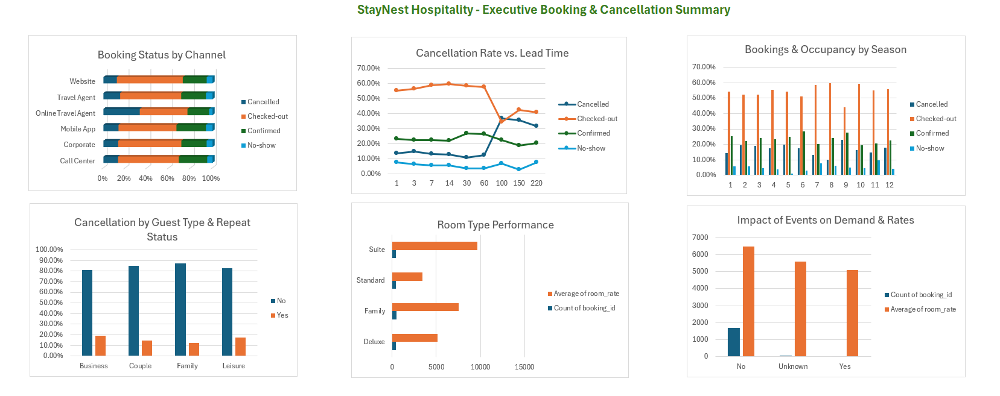

# Hotel Booking Insights & Analysis (Data Science SAT-2)

An end-to-end exploratory data analysis (EDA) and interactive dashboard exploring hotel booking patterns, cancellation trends, customer demographics, and revenue factors.

---

## 📌 Project Overview

This project investigates hotel reservation datasets to uncover key business drivers and operational trends. Through systematic data cleaning, analysis, and dashboard visualization, the goal is to identify factors leading to booking cancellations and uncover actionable insights to optimize booking management and revenue.

---

## 📊 Dashboard Preview

